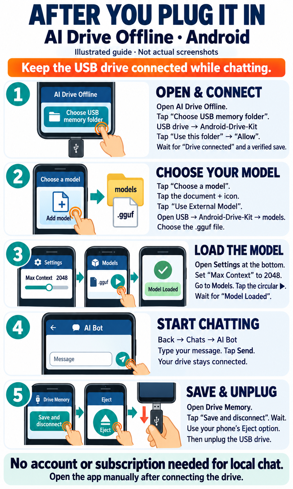

# AI Drive Offline — Android USB kit

This complete kit contains the Android installer, full Llama 3.2 3B Instruct
Abliterated model, instructions, application source and licenses. The app needs
an ARM64 Android device running Android 7 or newer. Available memory and USB
support affect compatibility and performance.

After connecting your prepared drive, open **START-HERE.txt**. The installer is
`apps/AI-Drive-Offline_v0.10.1-usb.2.apk`; Android requires you to install and open
it manually. Insertion does not automatically launch the app.

## Your picture guide

- **PICTURE-GUIDE.pdf** is the current one-page guide.
- **START-HERE.html** opens the same guide offline, with readable text steps.
- **customer-guide/After-You-Plug-It-In-usb2.png** is the standalone picture.
- **customer-guide/Earlier-Illustrations-usb1.pdf** preserves the older four-page
  illustrations separately. Use the current guide and START-HERE.txt for usb.2.

The pictures are illustrations, not actual screenshots. Select the exact folder
**USB drive → Android-Drive-Kit** for memory. Select the `.gguf` in its **models**
folder through **Choose a model → document-plus → Use External Model**. Keep the
drive connected while chatting and wait for saving before disconnecting it.

## Memory and tools

Full chat records, alternate replies, preferences, facts, notes, profiles and
personal assets automatically save to the chosen removable folder. The app's
conversation database and personal settings operate in RAM; attachments use
temporary cache mirrored into USB snapshots. There is no automatic phone or
cloud fallback. The app has no Internet permission and needs no account or
subscription for the included local model.

Memory files are unencrypted. Protect your drive. Complete stored history is
separate from the smaller selection that fits into a model prompt. See
**USB-MEMORY-AND-TOOLS.md** for storage limits and recovery details.

For a quick tool check, use **Drive Memory → Offline Toolkit**, choose the
calculator example, then **Run tool**. It should show **(12 + 8) * 3 = 60**.
The calculator works without loading the Llama model. Saved-memory and note
commands use the same verified removable-folder service.

## Validation and licenses

**APP-VALIDATION.json** records the evidence for the exact included installer.
The exact installer passed an in-place update, a fresh install, stable startup
and the calculator on an API 35 emulator. Manual facts and notes saved through
Android’s real folder-consent picker to a simulated removable volume; snapshot
SHA-256 checks and force-stop/relaunch restoration passed. The Choose a model
route and its Settings tab opened correctly. A virtual volume does not
establish physical USB compatibility. Physical-phone operation, physical USB
detach/reconnect and model inference inside this Android app remain untested;
retail readiness is not established.

This is an independently signed modified ChatterUI app. Matching modified source
is in **sources/AI-Drive-Offline-v0.10.1-usb.2-source.zip**; the AGPL license is in
**apps/ChatterUI-LICENSE.txt**. Build provenance is next to the installer.
**FILES-SHA256.json** identifies every payload.

Built with Llama. Llama 3.2 is licensed under the Llama 3.2 Community License,
Copyright © Meta Platforms, Inc. All Rights Reserved. Its license and notice are
in the **models** folder.
