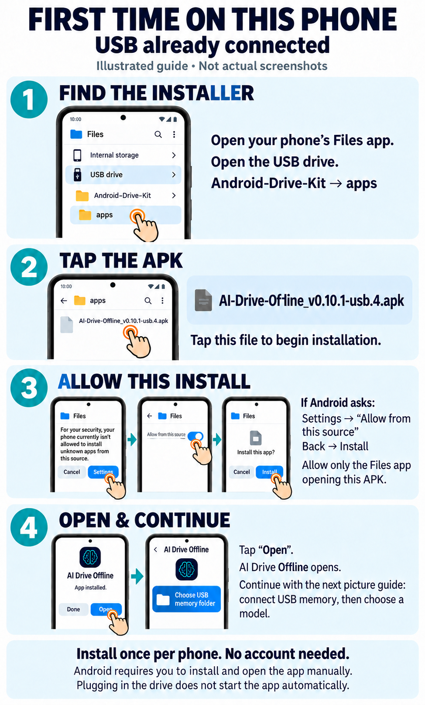
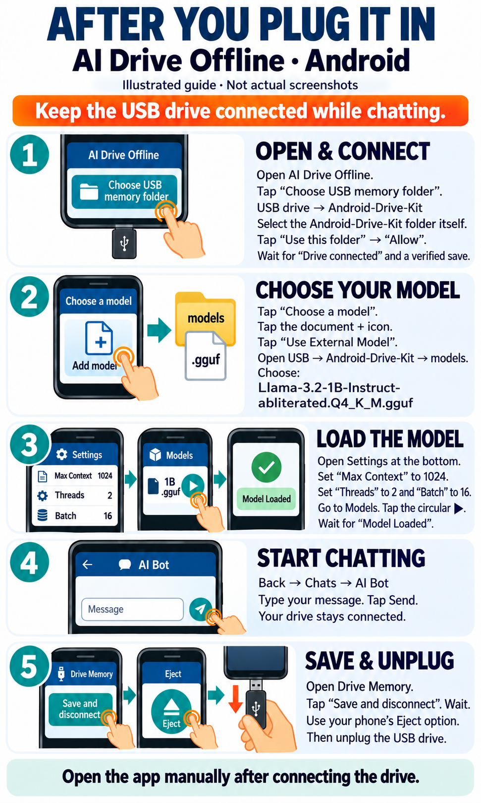

# AI Drive Offline — Android USB kit with Llama 3.2 1B

**Built with Llama.**

With the USB drive already connected to your ARM64 Android phone, open
**START-HERE.html**, **START-HERE.txt** or **PICTURE-GUIDE.pdf** on the drive.
Android requires you to install and open the app manually; connecting the drive
does not launch it automatically. Keep the **Android-Drive-Kit** folder together.
The two-page picture guide
covers installation once per phone, then connecting USB memory and loading the
model. Its screens are illustrations; Android wording can vary.

The installer is **apps/AI-Drive-Offline_v0.10.1-usb.4.apk**. In Drive Memory,
choose **USB drive → Android-Drive-Kit** itself and grant folder access. For the
model, use **Choose a model → document-plus icon → Use External Model**, then
select **models/Llama-3.2-1B-Instruct-abliterated.Q4_K_M.gguf**. Set **Max Context 1024 / Threads 2 / Batch 16**,
return to Models and tap the model's play button. Keep the drive connected.

The selected model is Llama 3.2 1B Instruct Abliterated, Q4_K_M, quantized by
**mradermacher**. The complete file is **955,445,792 bytes**. Its exact public
revision, URL, SHA-256 and lineage limitation are in **models/MODEL-PROVENANCE.json**.

Full stored conversation history, alternate replies, preferences, facts, notes
and profile text use the selected removable folder. Complete stored history is
separate from the bounded portion supplied to each model prompt.
Memory files are readable plaintext. Protect your drive. Storage limits and
recovery details are in **USB-MEMORY-AND-TOOLS.md**. The app has no Internet
permission and needs no account or subscription for the local model.

When finished, open **Drive Memory → Save and disconnect**, confirm in the dialog,
and wait for saving/checking to finish. If saving fails, keep the drive connected
and resolve the error. After a successful disconnect, use the phone's **Eject**
option if offered, then unplug. To resume, reconnect the same folder and load the
model again. A different phone must grant its own folder permission.

**APP-VALIDATION.json** records the actual checks and limits for this exact APK
and selected model. A model-load indication is separate from a generated reply
and restored generated-chat evidence. This exact APK and selected 1B model passed a genuine generated reply and
restoration of that same chat after force-stop/relaunch on an Android API 36
emulator in run 38880538406, job 116905926139. Both message bubbles, saved records,
native timings and the conversation archive were checked. This verifies one
conversation; it does not test every stored chat, profile item or media asset.
Physical Android phone and physical USB compatibility remain untested. Emulator
results do not establish phone speed, general model quality or retail readiness.

The app is an independently signed modified ChatterUI build. Matching source is
**sources/AI-Drive-Offline-v0.10.1-usb.4-source.zip**, with the AGPL license in
**apps/ChatterUI-LICENSE.txt**. Build provenance sits next to the APK.
**FILES-SHA256.json** in the completed kit identifies every included payload.

Llama 3.2 is licensed under the Llama 3.2 Community License, Copyright © Meta
Platforms, Inc. All Rights Reserved. The full model license and required NOTICE
are in **models**. See **REFERENCE-AND-LICENSE-NOTES.txt** for source and license
references, and **MODEL-VALIDATION.md** for the model evidence scope.
