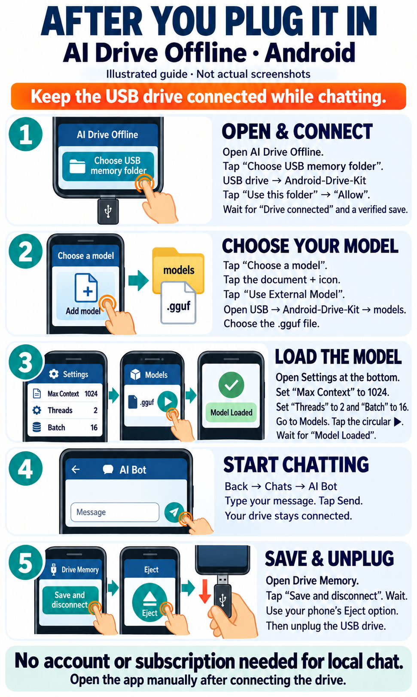

# Android downloads: AI Drive Offline

**Complete Android USB kit is being repaired; no finished complete-kit download yet.**

Real AI replies using **Llama 3.2 1B Instruct Abliterated** have passed on
Android 15 and 16 emulators. The generated-chat restart check is still being
verified. The installer below is available for app installation only; it does
not contain the model or the complete USB kit.

**[Download the Android app installer — usb.4, 67.7 MB](https://github.com/sutty1307/code-stick/raw/refs/heads/repair/android-runtime-usb4/portable/android/AI-Drive-Offline_v0.10.1-usb.4.apk)**

1. Open this page in **Chrome on the Android phone** and tap the installer link.
2. When the download finishes, open **Files > Downloads** and tap
   `AI-Drive-Offline_v0.10.1-usb.4.apk`.
3. If Android asks, tap **Settings > Allow from this source**, then go back and
   tap **Install > Open**. The permission may be for Files or Chrome, depending
   on which app opened the APK.
4. Open **AI Drive Offline**. No account is required. Android requires you to
   install and open the app manually; connecting a USB drive does not start it.

App installation, USB preference/note persistence and actual model replies have
passed emulator tests. The complete generated-chat restart check has not passed
yet. A physical phone and physical USB drive remain untested.
[Recorded Android model tests](https://github.com/sutty1307/code-stick/actions/runs/38878627822).

## Picture guide

[Open or download the two-page picture guide (PDF)](https://github.com/sutty1307/code-stick/raw/refs/heads/portable/android-usb-download/portable/android/Android-AI-Drive-Picture-Guide-usb4.pdf)

These are illustrations, not actual screenshots. They show the intended steps
**after the app and model files are already on a USB drive**. Those prepared files
are not offered as a finished kit here; generated-chat restart verification
is still in progress.
For the installer downloaded above, use **Files > Downloads** as described above.

## File verification and source

Installer: **67,666,025 bytes**. SHA-256:
`c833e55ff089903f3bc0e084f10b91516590fa5d9945138723e4ba466508d549`.

For developers: [corresponding modified application source](https://github.com/sutty1307/code-stick/raw/refs/heads/repair/android-runtime-usb4/portable/android/AI-Drive-Offline-v0.10.1-usb.4-source.zip)
and [AGPL-3.0 license](AI-Drive-Offline-AGPL-3.0.txt). You do not need the source
archive to install the app. Source archive: **3,811,006 bytes**. SHA-256:
`1a775d19b53faa8556a295880c303ef5e5f17bf1682d669c59ce79203072722e`.
